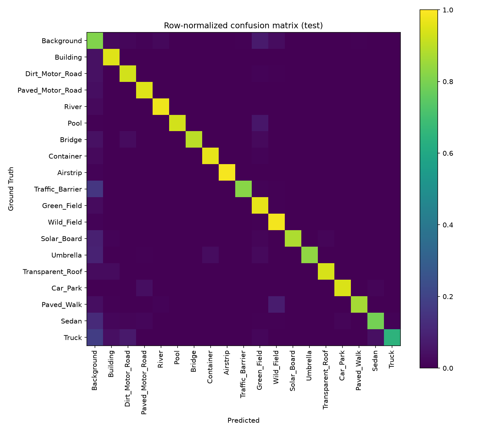

# Final results — training complete

Run finished all **100/100 epochs** (early stopping, patience 15, never
triggered — val_mIoU kept inching up in small increments the whole way,
so it never went 15 epochs without a new best). Best checkpoint: **epoch
98** (`results_256/checkpoints/best.pt`), val_mIoU **0.8201**.
`src/evaluate.py` was then run automatically on the held-out **test**
split (`AMtown03`/`AMvalley03`/`HKairport03`/`HKisland03`, 3,285 images)
— this is the fair, final, converged number; treat everything in
`training_progress_summary.md` and `classwise_val_iou_results.md` as the
in-progress diagnostics that led here.

## Headline test-set numbers

| Metric | Value (excl. Background) |
|---|---|
| Test Loss | 0.4915 |
| Pixel Accuracy | 0.9428 |
| **Mean IoU** | **0.8055** |
| Mean Precision | 0.8717 |
| Mean Recall | 0.9031 |
| Mean F1 | 0.8857 |

Full outputs: `../results_256/test_eval/` (`results.json`, `results.txt`,
`confusion_matrix.png`, 10 sample visualizations). Copies of the
confusion matrix and three representative samples are in `images/` for
reference (see below).

## Per-class (test)

| Class | IoU | Precision | Recall | F1 | Support (px) |
|---|---|---|---|---|---|
| Background* | 0.7201 | 0.868 | 0.809 | 0.837 | 33,160,845 |
| Building | 0.8424 | 0.880 | 0.951 | 0.914 | 7,836,972 |
| Dirt_Motor_Road | 0.7932 | 0.842 | 0.932 | 0.885 | 4,692,014 |
| Paved_Motor_Road | 0.8602 | 0.901 | 0.950 | 0.925 | 3,104,198 |
| River | 0.9101 | 0.933 | 0.974 | 0.953 | 10,584,975 |
| Pool | 0.8891 | 0.950 | 0.932 | 0.941 | 36,549 |
| Bridge | 0.8004 | 0.882 | 0.897 | 0.889 | 25,645 |
| Container | 0.8373 | 0.865 | 0.963 | 0.911 | 380,337 |
| Airstrip | 0.9606 | 0.975 | 0.985 | 0.980 | 3,728,664 |
| **Traffic_Barrier** | **0.5345** | 0.604 | 0.823 | 0.697 | 322,123 |
| Green_Field | 0.9289 | 0.965 | 0.961 | 0.963 | 79,719,857 |
| Wild_Field | 0.9563 | 0.972 | 0.983 | 0.978 | 68,153,361 |
| Solar_Board | 0.8359 | 0.947 | 0.877 | 0.911 | 102,116 |
| Umbrella | 0.7295 | 0.852 | 0.836 | 0.844 | 18,252 |
| Transparent_Roof | 0.8727 | 0.923 | 0.941 | 0.932 | 217,208 |
| Car_Park | 0.8359 | 0.879 | 0.945 | 0.911 | 278,756 |
| Paved_Walk | 0.8181 | 0.936 | 0.867 | 0.900 | 2,570,014 |
| **Sedan** | **0.6058** | 0.721 | 0.791 | 0.755 | 319,210 |
| **Truck** | **0.4875** | 0.663 | 0.648 | 0.655 | 34,664 |

*Background is trained on but excluded from the mean; shown for
completeness.

## Val vs. test: the honest comparison

| | Val (best epoch, 4,207 imgs) | Test (held-out, 3,285 imgs) |
|---|---|---|
| Mean IoU | 0.8201 | **0.8055** |
| Pixel Accuracy | ~0.952 (epoch 66 snapshot; not re-measured at ep. 98) | 0.9428 |

Test mIoU comes in **~1.5 points below** the best val score, which is the
expected, healthy direction — val was used to pick the checkpoint, so it
should score at least slightly optimistic relative to a truly held-out
set. A 1.5-point gap (not 10+) says the model isn't badly overfit to val
specifically.

Per-class, the same three classes that were weakest throughout training
are still the weakest on test, in the same order — **Truck (49%) <
Traffic_Barrier (53%) < Sedan (61%)** — consistent with the mid-training
snapshots in `classwise_val_iou_results.md`. Truck dropped the most from
val to test (was ~66-68% on val snapshots, 49% on test) — plausible given
it's the second-rarest class in the whole taxonomy (34,664 test pixels,
14k total dynamic instances dataset-wide per the paper's own Table 2) and
therefore the highest-variance estimate of the bunch.

## Reading the confusion matrix

Row-normalized (each row sums to 1, so a cell shows "of all true pixels
of this class, what fraction got predicted as the column class"). Diagonal
is strong and clean almost everywhere — a handful of things worth calling
out:

- **Background's row has visible bleed into several columns** — mainly
  because Background is the "everything else" catch-all bordering every
  other class, so it inherits boundary-pixel disagreement from all of
  them simultaneously. This matches its middling 72% IoU despite being
  the most frequent class.
- **Truck's row is the most spread-out of any class** — visible bleed
  toward Background and Sedan specifically. Truck vs. Sedan confusion is
  intuitive (both are the "vehicle" super-category in every other project
  in this workspace) and Truck vs. Background is a small-object boundary
  effect (34k pixels total in the whole test set — a handful of mislabeled
  boundary pixels per instance is a large relative hit to a class this
  small).
- **Traffic_Barrier bleeds mainly into Background** — consistent with its
  low precision (60%) alongside high recall (82%): the model finds real
  barriers reliably but also fires on some Background regions that
  resemble them, which is exactly what median-frequency class weighting
  (rare classes weighted up to 10x) predicts — the loss pushes the model
  to favor recall on rare classes at some precision cost.
- Every other class's row is essentially a single bright diagonal cell —
  no other systematic confusion pattern.

## Qualitative samples

Three representative test predictions (Image | Ground Truth | Prediction),
picked to show a range of scenes and object sizes:

**`images/test_sample_forest_road.png`** — dense forest with a road
cutting through; prediction matches ground truth almost pixel-for-pixel,
including the road's irregular boundary.

**`images/test_sample_farmland_riverbank.png`** — mixed farmland/riverbank
scene with a building, a road strip, and two field types (Green_Field vs.
Wild_Field); prediction correctly separates all of these, including the
subtle field-type boundary in the lower half.

**`images/test_sample_courtyard.png`** — a paved courtyard/complex with a
small vehicle and a road strip; this one shows a real error — the
prediction adds a dark-red (Building) patch in the lower-left that isn't
in ground truth, and the vehicle blob is present but shape is slightly
off. A useful example that the model isn't perfect — it has real,
visible failure modes, not just abstract per-class numbers.

## How this fits with the rest of `analysis/`

- `paper_comparison.md` — why this run's numbers land well above the
  paper's UperNet+backbone benchmark (different decoder, different input
  crop, different loss) — still fully applicable; nothing here changes
  that reasoning; if anything, the confusion-matrix findings above (Truck
  and Traffic_Barrier as the genuine weak points) reinforce it: these are
  exactly the small/rare classes the paper's 224x224 center-crop protocol
  would struggle with even harder than it already does.
- `val_class_distribution.md` — confirms none of these per-class numbers
  are artifacts of a class being absent from evaluation data.
- `training_progress_summary.md` / `classwise_val_iou_results.md` — the
  in-progress snapshots (epochs 45, 66) that this final result grew out
  of; useful for seeing the trend, now superseded as "the answer" by this
  file for anything that needs a single final number.
