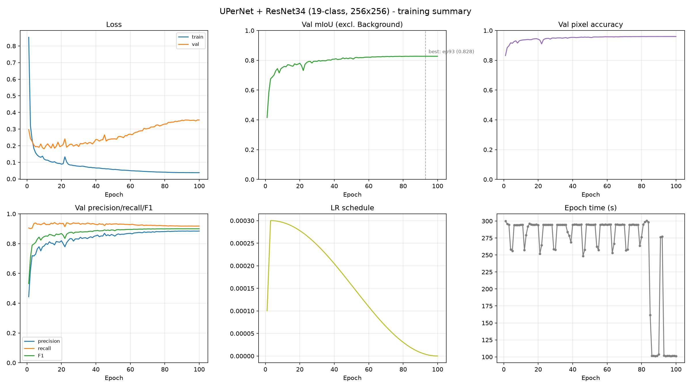
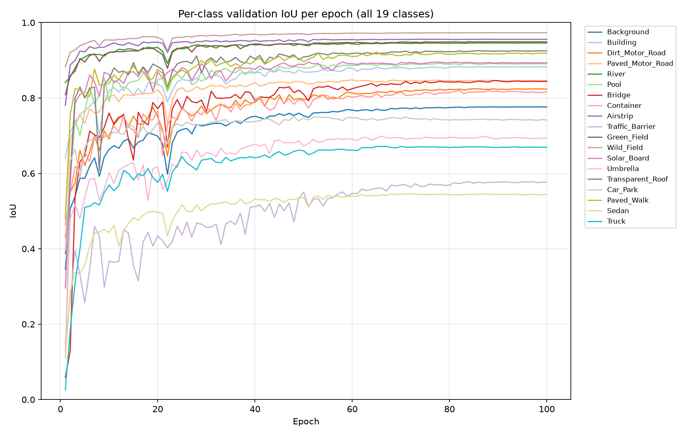
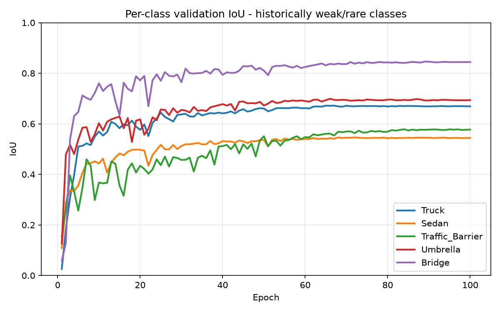

# UPerNet (ResNet-34) — 19-Class UAV Scene Segmentation @ 256×256
### Results Presentation

---

## Slide 1 — Objective

- Semantic segmentation of UAV aerial imagery into **19 named scene classes** (UAVScenes taxonomy), at **256×256** input resolution.
- Architecture under test: **UPerNet decoder + ResNet-34 encoder** (ImageNet-pretrained), via `segmentation_models_pytorch`.
- Goal: establish a strong, fully-trained baseline for this decoder/backbone/resolution combination.

---

## Slide 2 — Setup at a Glance

| | |
|---|---|
| Input resolution | 256 × 256 |
| Classes | 19 (Background + 18 named UAVScenes classes) |
| Encoder | ResNet-34 (ImageNet pretrained) |
| Decoder | UPerNet (Xiao et al., 2018) |
| Loss | 0.5 × Dice + 0.5 × class-weighted Cross-Entropy |
| Optimizer | AdamW, lr 3e-4, weight decay 1e-4 |
| LR schedule | 3-epoch linear warmup → cosine decay to 0 |
| Batch size | 32 |
| Epochs | 100 (no early stop triggered) |
| Mixed precision | Enabled (AMP) |
| Gradient clipping | Max norm 5.0 |
| Seed | 42 |

---

## Slide 3 — Headline Results (Best Checkpoint, Epoch 93)

| Metric | Value |
|---|---|
| **Val mIoU** (18 classes, Background excluded) | **0.8275** |
| Val pixel accuracy | 0.9597 |
| Val mean F1 | 0.8999 |
| Val mean precision | 0.8847 |
| Val mean recall | 0.9179 |
| Train loss (final) | 0.0378 |

- Training ran the full 100 epochs; performance plateaued from ~epoch 85 onward.
- Best model saved automatically as `results_256/checkpoints/best.pt`.

---

## Slide 4 — Training Curves

- **Loss:** train loss falls smoothly and monotonically for all 100 epochs; val loss bottoms out early (~epoch 7) then drifts upward while mIoU keeps improving (see Technical README for why this is expected here, not a red flag on its own).
- **mIoU / accuracy:** rapid gains through epoch ~40, then slow, steady refinement to the epoch-93 peak.
- **Precision/recall/F1:** recall leads precision throughout — the model over-predicts positive classes slightly more than it under-predicts them.

---

## Slide 5 — Per-Class IoU (Best Epoch)

| Rank | Class | IoU |
|---|---|---|
| 1 | Wild_Field | 0.973 |
| 2 | Airstrip | 0.956 |
| 3 | Green_Field | 0.949 |
| 4 | River | 0.946 |
| 5 | Transparent_Roof | 0.925 |
| 6 | Paved_Walk | 0.919 |
| 7 | Solar_Board | 0.893 |
| 8 | Pool | 0.890 |
| 9 | Building | 0.883 |
| 10 | Paved_Motor_Road | 0.846 |
| 11 | Bridge | 0.844 |
| 12 | Dirt_Motor_Road | 0.824 |
| 13 | Container | 0.818 |
| 14 | Background | 0.776 |
| 15 | Car_Park | 0.743 |
| 16 | Umbrella | 0.695 |
| 17 | Truck | 0.670 |
| 18 | Traffic_Barrier | 0.576 |
| 19 | Sedan | 0.545 |

**Takeaway:** large, texturally-distinct land-cover classes (fields, water, airstrip) are near-solved. The weakest classes are small/thin/rare objects — **Sedan, Traffic_Barrier, Truck, Umbrella** — consistent with the known difficulty profile for this taxonomy.

---

## Slide 6 — Weak-Class Focus

- Truck, Sedan, Traffic_Barrier, Umbrella, Bridge tracked across all 100 epochs.
- All five improve steadily but plateau below the model's overall average — they are the clear target for the next round of improvements.

---

## Slide 7 — Qualitative Results

- Fixed set of 10 validation images visualized every epoch: `results_256/progress/epoch_XXX.png`.
- `epoch_001.png` → `epoch_100.png` shows the same scenes evolving from near-random predictions to clean, sharply-bounded segmentation masks.
- Recommended for the deck: side-by-side of `epoch_001.png`, `epoch_050.png`, and `epoch_093.png` (best) to show visual progression.

---

## Slide 8 — Operational Note

- Training was interrupted once by a hard GPU/driver-level crash mid-epoch-93 (not a data or code bug — see Technical README).
- Recovered automatically from the last saved checkpoint (`results_256/checkpoints/last.pt`, epoch 92) with **zero loss of training progress**, and completed the remaining epochs without further incident.

---

## Slide 9 — Summary

- Fully trained 100-epoch baseline: **0.8275 val mIoU**, **0.960 pixel accuracy** on 19-class UAV scene segmentation at 256×256.
- 14 of 19 classes exceed 0.77 IoU; 5 small/rare/dynamic classes remain the improvement target.
- See the accompanying **Technical README** for full reasoning, root-cause analysis, and the improvement roadmap.

---

*All figures generated from `results_256/metrics.csv` and `results_256/per_class_iou.csv` via `analysis/scripts/plot_training_curves.py`.*
